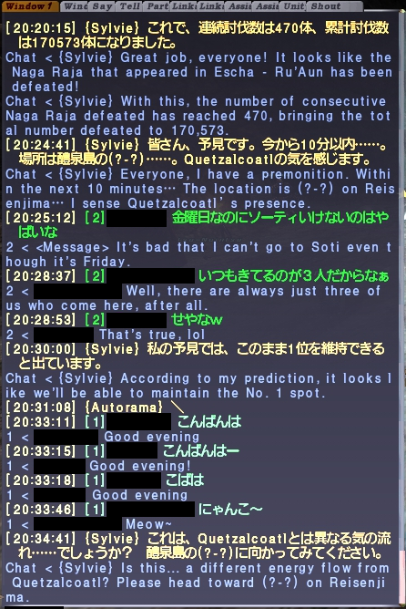

# AutoTranslator

FINAL FANTASY XI (Windower 4) 用の、チャット自動翻訳アドオンです。
English follows the Japanese section. → [English](#english)

---

## 日本語

### できること

- **会話のチャットを自動で翻訳**して、チャットログに `発言者 < 訳文` の形で表示します。
  - 対象: say / shout / yell / tell / party / リンクシェル 1・2 / ユニティ
  - システムメッセージ、NPC の会話、戦闘ログ、ほかのアドオンの表示は翻訳しません。/echo も、初期設定では翻訳しません（`//at mode` で有効にできます）。
- **英語 → 日本語** と **日本語 → 英語** の両方に対応しています（`//at lang ja` / `//at lang en`）。
- **翻訳中もゲームが止まりません。** 翻訳は別のプログラム（PowerShell の翻訳ヘルパー）が行うので、ヘルパーが動いているあいだは、翻訳を待ってもゲームは止まりません。
- **エリア名をゲームの正式な名前で訳します。**
  - 例: `lets go to Norg` → 「ノーグに行こう」（DeepL だけだと「ノルグ」「ノルウェー」になります）
  - 例: `ジュノ港で待ち合わせしましょう` → `Let's meet up at Port Jeuno.`
- **定型文辞書（Tab 変換）をゲームと同じ表記で表示します。**
  - 例: `[at]100 Byne Bill[/at]` → `[100バイン紙幣]`
  - 定型文だけの発言（yell の売買の行など）は、API を使わずにすぐ表示します。
- **FF11 のスラング・略語を、分かる言葉にしてから翻訳します。**（v3.2.0）
  - 例: `voke the mob` → 「敵を挑発する」（DeepL だけだと「暴徒を煽る」になります）
  - 例: `lf1m for omen, need whm` → 「オーメンのメンバーをあと1名募集しています。白魔道士が必要です。」
  - ジョブ名（`whm` `cor` `brd` …）や `sc`（連携）、`th`（トレジャーハンター）など 60 語ほどを最初から登録しています（`data/slang.xml`）。
  - 同じ略語でも意味が変わるものは、同じ発言や直前の発言の言葉を見て使い分けます。例: `mb` は、連携の話の中なら「マジックバースト」、それ以外は「my bad（ごめん）」。
  - 略語は `//at slang add <略語> <意味>` で追加できます。意味を日本語で書くとそのまま訳文に入り、英語で書くと翻訳サービスがその英語を訳します。
- **直前の発言を参考にして訳します。**（v3.2.0）同じチャットの直前の発言（最大 3 行・2 分以内）を、翻訳サービスに参考情報として渡します。DeepL では、参考情報は訳されず、文字数にも数えられません。
- 一度翻訳した文は覚えておき、2 回目からはすぐに表示します。
- 翻訳サービスは **DeepL**（おすすめ）、**OpenAI**、**Claude**、**Azure Translator**（v3.3.0・毎月リセットされる無料枠あり）から選べます。うまくいかないときは、キーが設定されているほかのサービスを順に試します。

### 表示例



日本語の発言には英語の訳が、英語の発言には日本語の訳が、チャットログに続けて表示されます（プレイヤー名は画像で隠しています）。

### 必要なもの

**追加でインストールするソフトウェアや Lua のライブラリはありません。** 次のものがそろっていれば動きます。

| 必要なもの | 説明 | 入っていない・動かないとき |
|---|---|---|
| Windower 4 | 使う Lua のライブラリ（`config` `texts` `resources` `ltn12`）は Windower に付属しています | Windower を起動して最新の状態に更新してください |
| Windows 10 / 11 | 下の 2 つが最初から入っています | — |
| Windows PowerShell 5.1 | 翻訳ヘルパー（`helper/at_helper.ps1`）を動かします | Windows 10 / 11 には標準で入っています。古い Windows では「Windows Management Framework 5.1」が必要です |
| VBScript | 翻訳ヘルパーを、画面を出さずに起動するのに使います（`helper/start_helper.vbs`） | 下の「VBScript が無効になっている場合」を見てください |
| インターネット接続 | 翻訳サービス（DeepL など）に問い合わせます | ウイルス対策ソフトやファイアウォールが PowerShell の通信を止めていないか確認してください |
| 翻訳サービスの API キー | どれか 1 つ。下の「API キーの作り方」を参照 | — |

#### VBScript が無効になっている場合

Microsoft は VBScript を段階的に廃止する予定で、Windows 11 の新しい版では「オプション機能」になっています（多くの場合、最初は有効です）。AutoTranslator を読み込んでも翻訳されず、`[AutoTranslator API Error] no response from translator helper (timeout)` と出るときは、次を確認してください。

1. Windows の「設定」→「システム」→「オプション機能」を開きます。
2. 「VBSCRIPT」が一覧にあるか確認します。無ければ「機能を表示（追加）」から「VBSCRIPT」を追加し、パソコンを再起動します。

#### ウイルス対策ソフトについて

翻訳ヘルパーは「画面に出ない PowerShell がインターネットに接続する」という動きをするため、ウイルス対策ソフトによっては止められることがあります。止められた場合は、`Windower/addons/AutoTranslator/helper/` フォルダを除外（許可）の対象に加えてください。中身はすべてテキストのスクリプトなので、事前に内容を確認できます。

### API キーの作り方

| サービス | 登録・プラン | API キーを作るページ |
|---|---|---|
| **DeepL**（おすすめ） | https://www.deepl.com/pro-api | https://www.deepl.com/your-account/keys |
| **OpenAI** | https://platform.openai.com/signup | https://platform.openai.com/api-keys |
| **Anthropic (Claude)** | https://console.anthropic.com/ | https://console.anthropic.com/settings/keys |
| **Azure Translator** | https://azure.microsoft.com/free | Azure ポータルの Translator の「キーとエンドポイント」 (下の手順) |

- **DeepL**: DeepL の無料のプラン (API Developer) は、**一回限りの 100 万文字**までです (毎月の無料枠ではありません。2026-10-26 に画面で確認)。使い切ると有料になります。登録後、「API キー」のページでキーをコピーします（無料版のキーは末尾が `:fx`）。
- **OpenAI / Anthropic**: アカウントを作り、支払い方法（クレジット）を登録してから、API キーのページで新しいキーを作ります。キーは作ったときに一度しか表示されないので、すぐにコピーしてください。利用した分だけ料金がかかります。
- 料金・無料枠・登録の手順は変わることがあります。最新の情報は各サービスのページで確認してください。

#### Azure Translator（毎月リセットされる無料枠があります）

Microsoft Azure の翻訳サービスです。**無料の価格レベル「Free F0」は、毎月 200 万文字まで無料で、翌月にリセットされます**（Microsoft の料金ページに「2 million characters ... free per month」とあります。2026-10-26 に確認）。DeepL の無料枠は一回限りなので、毎月使うなら Azure が向いています。

> **重要: 価格レベルは、必ず「Free F0」を選んでください。** 有料の層（S1 など）を選ぶと、使った文字数に応じて**料金がかかります**。無料の層は、1 つのサブスクリプションに 1 つだけ作れます。

1. https://azure.microsoft.com/free で、無料の Azure アカウントを作ります。**本人確認のために、クレジットカードの登録が必要です。** 画面には「従量課金に切り替えない限り、請求されない」と書かれています（2026-10-26 時点の表示）。無料アカウントには、最初の 30 日間だけ使えるクレジットも付きます。切り替えを求められたときは、Microsoft の案内を読んで、ご自身で判断してください。
2. Azure ポータル https://portal.azure.com/ にサインインし、Translator の作成ページ https://portal.azure.com/#create/Microsoft.CognitiveServicesTextTranslation を開きます。
3. 次のように入力します。
   - **サブスクリプション**: 無料アカウントで作られたもの（通常は 1 つだけ）
   - **リソース グループ**: 「新規作成」で、好きな名前
   - **リージョン**: 「グローバル」（特別な理由がなければ）
   - **名前**: Azure 全体で重複しない名前
   - **価格レベル**: **「Free F0」を選ぶ**（ここで有料の層を選ぶと、料金がかかります）
4. 「確認と作成」→「作成」。終わったら「リソースに移動」を押します。
5. 左のメニューの「リソース管理」にある「**キーとエンドポイント**」で、「キー 1」をコピーします。同じ画面の「場所/リージョン」が `global` 以外（例: `japaneast`）のときは、その文字列も控えます。
6. 念のため、Azure の「コスト管理」で、予算のアラート（例: 月 1 ドルを超えたらメール）を作っておくと安心です。

Azure で訳すと、英語 → 日本語のときに、`glossary_en_ja.tsv` の地名・エリア名を、ゲームの日本語名に固定して訳します（Azure の辞書の指定を使います。`lets go to Norg` → 「ノーグに行こう」）。日本語 → 英語は、DeepL と同じく、送る前に地名を英語名に置き換えます。

### 入れ方

1. このフォルダを `Windower/addons/AutoTranslator/` に置きます。
   （`Windower/addons/AutoTranslator/AutoTranslator.lua` となるように）
2. 設定ファイルを作ります。次のどちらかの方法で作れます。
   - `data/filler.xml.example` をコピーして、**アドオンのフォルダ直下**に `filler.xml` という名前で置く
   - または、ゲーム内で一度 `//lua l autotranslator` を打つ（`filler.xml` が自動で作られます）
3. ゲーム内で `//lua u autotranslator` を打って、いったん外します。
4. `filler.xml` をメモ帳などで開き、使うサービスの API キーを書き込んで保存します。
   ```xml
   <api_keys>
       <deepl>ここに DeepL の API キー</deepl>
       <openai>YOUR_OPENAI_API_KEY</openai>
       <claude>YOUR_CLAUDE_API_KEY</claude>
       <azure>ここに Azure のキー 1</azure>
       <azure_region></azure_region>
   </api_keys>
   ```
   - 使わないサービスは `YOUR_...` のままで構いません。
   - `<azure_region>` は、Azure の「場所/リージョン」が `global` なら空のままで構いません。`japaneast` などのときは、その文字列を書きます。
   - DeepL 無料版のキーは末尾が `:fx` です。自動で無料版の窓口を使います。
5. ゲーム内で `//lua l autotranslator` を打って読み込みます。

> **注意:** AutoTranslator を読み込んだまま `filler.xml` を書き換えると、アドオンが設定を保存したときに古い内容で上書きされることがあります。書き換えるときは、必ず先に `//lua u autotranslator` で外してください。

### コマンド

| コマンド | 内容 |
|---|---|
| `//at lang ja` | 英語 → 日本語に翻訳する（日本語を使う人向け） |
| `//at lang en` | 日本語 → 英語に翻訳する（英語を使う人向け） |
| `//at provider deepl` / `openai` / `claude` / `azure` | 最初に使う翻訳サービスを選ぶ |
| `//at test <文>` | 翻訳を試す（例: `//at test good morning`） |
| `//at add <単語> <訳>` | 辞書に追加する（辞書にある発言は API を使わずに訳します） |
| `//at del <単語>` | 辞書から削除する |
| `//at dict` | 辞書の一覧を表示する |
| `//at mode <種類...>` | 翻訳するチャットの種類を選ぶ（例: `//at mode party ls tell`）。種類: say shout yell tell party ls unity echo |
| `//at mode status` | 翻訳するチャットの種類を表示する |
| `//at block <名前>` / `//at unblock <名前>` | その人の発言を翻訳しない／元に戻す（`//at block` だけで一覧を表示） |
| `//at word add <語>` / `//at word del <語>` | その語を含む発言を翻訳しない（NG ワード） |
| `//at slang add <略語> <意味>` / `//at slang del <略語>` | スラング・略語の辞書に追加／削除する（例: `//at slang add omw on my way`） |
| `//at slang list` / `//at slang reload` | スラングの辞書を表示する／`data/slang.xml` を書き換えたあと読み込み直す |
| `//at typo add <誤字> <正しい綴り>` | よくある誤字の補正表に追加する（`del` / `list` も同じ。表は `data/typo.xml`） |
| `//at hud` | 翻訳結果を表示する小さな画面の ON / OFF（`//at hud reset` で位置を戻す） |
| `//at toggle` | 翻訳の ON / OFF |

### しくみ

```
ゲーム (Lua)                                 翻訳ヘルパー (PowerShell, 画面なし)
  チャットを受け取る
  辞書・キャッシュにあればすぐ表示
  無ければ data/queue/<id>.req を書く  ───▶  依頼を見つけて API に問い合わせる
  0.1 秒ごとに結果を確認             ◀───  data/queue/<id>.res を書く
  結果をチャットに表示
```

- 翻訳ヘルパー（`helper/at_helper.ps1`）は、AutoTranslator を読み込んだときに `helper/start_helper.vbs` から画面を出さずに起動します。
- AutoTranslator を外したとき、読み込み直したとき、ゲームを終了したとき（30 秒後）に、翻訳ヘルパーは自分で終了します。
- エリア名は Windower の一覧（`res/zones.lua`, `res/regions.lua`）から、定型文は `res/auto_translates.lua`、`res/items.lua` などから日本語名・英語名を引きます。
- 英語 → 日本語では、エリア名の対応表を **DeepL の用語集** として自動で登録して使います。
  - DeepL 無料版では用語集を 1 つしか作れないため、日本語 → 英語では用語集を使わず、送る前に地名を英語名に置き換えます。
  - 用語集の登録情報は `data/deepl_glossary.txt` に保存されます（API キーが変わったときは自動で登録し直します）。
- 翻訳ヘルパーの動きは `data/queue/helper.log` に記録されます（API キーは記録しません）。

### 注意

- **API キーは `filler.xml` に平文で保存されます。** `filler.xml` は `.gitignore` で除外しています。GitHub などに上げないでください。
- 翻訳サービスの利用料金・文字数の上限は、各サービスの規約に従います。
- **翻訳サービスに送られる内容:** 翻訳する発言の本文と、同じチャットの直前の発言（最大 3 行・2 分以内）が、DeepL / OpenAI / Claude のうち設定したサービスへ送られます。そのサービスが失敗したときは、`filler.xml` にキーが入っているほかのサービスにも、順に送られます（使わないサービスのキーは `YOUR_...` のままにしてください）。**他の人の発言だけでなく、自分の発言も、tell（個人宛）も対象です。他のプレイヤーの発言は、その人に断らずに外部のサービスへ送られます。** 送りたくないチャットの種類は `//at mode` で外してください。直前の発言には「発言者名: 本文」の形で名前が付いて送られます。各サービスの規約とプライバシーの扱いは、各自で確認してください。
- **翻訳ヘルパーの起動のしかた:** `helper/start_helper.vbs` が、画面を出さずに `powershell.exe -NoProfile -NonInteractive -ExecutionPolicy Bypass -WindowStyle Hidden -File at_helper.ps1` を起動します。Windower の `windower.execute` では引数を渡せないため、この方法にしています。起動するのはアドオンのフォルダ内のスクリプトだけで、中身はすべてテキストです。
- 翻訳の本文はログに残しません。`data/queue/` の依頼ファイル（`.req`）は、ヘルパーが読んだ直後に消えます。
- OpenAI / Claude で使うモデル名は `helper/at_helper.ps1` の中にあります。提供が終わったモデルの場合は書き換えてください。
- Windower を含む外部ツールの利用は、FFXI の利用規約では認められていません。アカウントに不利益が及ぶ可能性があり、作者は責任を負えません。自己責任で使ってください。

### ライセンス

MIT License です。詳しくは [LICENSE](LICENSE) を見てください。

---

<a id="english"></a>

## English

### Features

- **Automatically translates conversation chat** and shows it in the chat log as `Speaker < translation`.
  - Translated: say / shout / yell / tell / party / linkshell 1 & 2 / unity
  - Not translated: system messages, NPC dialogue, battle logs, and output from other addons. /echo is not translated by default either (`//at mode` can turn it on).
- Works in **both directions: English → Japanese** and **Japanese → English** (`//at lang ja` / `//at lang en`).
- **The game does not freeze while the helper is running.** Translation runs in a separate program (a PowerShell translator helper), so waiting for a translation does not stop the game.
- **Area names are translated using the official in-game names.**
  - e.g. `lets go to Norg` → 「ノーグに行こう」 (DeepL alone gives "ノルグ" or "ノルウェー", which is Norway)
  - e.g. `ジュノ港で待ち合わせしましょう` → `Let's meet up at Port Jeuno.`
- **Auto-translate phrases (Tab completion) are shown exactly as the game writes them.**
  - e.g. `[at]100 Byne Bill[/at]` → `[100バイン紙幣]`
  - Messages made only of auto-translate phrases (such as yell trade lines) are shown instantly without calling an API.
- **FFXI slang and abbreviations are rewritten into plain words before translating.** (v3.2.0)
  - e.g. `voke the mob` → 「敵を挑発する」 (DeepL alone gives "暴徒を煽る", "incite the rioters")
  - e.g. `lf1m for omen, need whm` → 「オーメンのメンバーをあと1名募集しています。白魔道士が必要です。」
  - About 60 terms are registered by default (`data/slang.xml`): job names (`whm` `cor` `brd` …), `sc` (skillchain), `th` (Treasure Hunter), and more.
  - Abbreviations with more than one meaning are resolved from the same message or the previous ones. e.g. `mb` becomes "Magic Burst" when skillchains are being discussed, and "my bad" otherwise.
  - Add your own with `//at slang add <abbreviation> <meaning>`. A Japanese meaning is inserted into the translation as is; an English meaning is translated by the service.
- **Previous messages are used as context.** (v3.2.0) Up to 3 earlier lines from the same chat (within 2 minutes) are passed to the translation service as reference. With DeepL, this context is not translated and is not counted toward your character usage.
- Translations are cached, so the same message appears instantly the second time.
- Choose your translation service: **DeepL** (recommended), **OpenAI**, **Claude**, or **Azure Translator** (v3.3.0; has a free allowance that resets every month). If one fails, the other services that have a key are tried in order.

### Example


Japanese messages are followed by an English translation, and English messages by a Japanese one, right in the chat log (player names are hidden in the image).

### Requirements

**No additional software or Lua libraries need to be installed.** It works as long as you have the following:

| Requirement | Description | If it is missing or not working |
|---|---|---|
| Windower 4 | The Lua libraries used (`config`, `texts`, `resources`, `ltn12`) come with Windower | Start Windower and let it update to the latest version |
| Windows 10 / 11 | Includes the next two items | — |
| Windows PowerShell 5.1 | Runs the translator helper (`helper/at_helper.ps1`) | Included with Windows 10 / 11. Older Windows needs "Windows Management Framework 5.1" |
| VBScript | Starts the translator helper without showing a window (`helper/start_helper.vbs`) | See "If VBScript is disabled" below |
| Internet connection | Used to contact the translation service (DeepL, etc.) | Check that your antivirus or firewall is not blocking PowerShell's network access |
| A translation service API key | At least one. See "Getting an API key" below | — |

#### If VBScript is disabled

Microsoft plans to phase out VBScript, and newer versions of Windows 11 make it an "optional feature" (usually enabled by default). If nothing is translated after loading AutoTranslator and you see `[AutoTranslator API Error] no response from translator helper (timeout)`, check the following:

1. Open Windows **Settings** → **System** → **Optional features**.
2. Check that "VBSCRIPT" is in the list. If it is not, add "VBSCRIPT" via **View features (Add a feature)** and restart your PC.

#### About antivirus software

The translator helper is "a PowerShell script with no window that connects to the internet", so some antivirus software may block it. If that happens, add the `Windower/addons/AutoTranslator/helper/` folder to your antivirus exclusions (allow list). Everything in it is a plain-text script, so you can review it beforehand.

### Getting an API key

| Service | Sign-up / plans | Create an API key |
|---|---|---|
| **DeepL** (recommended) | https://www.deepl.com/pro-api | https://www.deepl.com/your-account/keys |
| **OpenAI** | https://platform.openai.com/signup | https://platform.openai.com/api-keys |
| **Anthropic (Claude)** | https://console.anthropic.com/ | https://console.anthropic.com/settings/keys |
| **Azure Translator** | https://azure.microsoft.com/free | "Keys and Endpoint" of your Translator resource in the Azure portal (steps below) |

- **DeepL**: The free DeepL API plan ("API Developer") gives a **one-time (lifetime) allowance of 1,000,000 characters**, not a monthly one (checked on the account page on 2026-10-26). After that it is paid. After signing up, copy your key from the "API keys" page (free-plan keys end with `:fx`).
- **OpenAI / Anthropic**: Create an account, add a payment method (credits), then create a new key on the API keys page. The key is shown only once when it is created, so copy it right away. You pay for what you use.
- Prices, free quotas, and sign-up steps may change. Check each service's site for the latest information.

#### Azure Translator (free allowance that resets every month)

Microsoft Azure's translation service. **The free pricing tier "Free F0" gives 2,000,000 characters per month at no cost, and it resets every month** (Microsoft's pricing page says "2 million characters ... free per month"; checked 2026-10-26). DeepL's free allowance is one-time only, so Azure suits monthly use.

> **Important: always choose the pricing tier "Free F0".** If you pick a paid tier (S1 and so on), you **will be charged** for the characters you use. Only one free resource is available per subscription.

1. Create a free Azure account at https://azure.microsoft.com/free. **A credit card is required for identity verification.** The sign-up screen says you will not be charged unless you move to pay-as-you-go pricing (as shown on 2026-10-26). The free account also includes a credit that is usable for the first 30 days. If you are asked to switch plans, read Microsoft's notice and decide for yourself.
2. Sign in to the Azure portal at https://portal.azure.com/ and open the Translator creation page: https://portal.azure.com/#create/Microsoft.CognitiveServicesTextTranslation
3. Fill in the form:
   - **Subscription**: the one created with your free account (usually the only one)
   - **Resource group**: create a new one with any name
   - **Region**: "Global" (unless you have a specific reason)
   - **Name**: a name that is unique across Azure
   - **Pricing tier**: **choose "Free F0"** (a paid tier here will be billed)
4. Click "Review + create", then "Create". When it finishes, click "Go to resource".
5. In the left menu, under "Resource Management", open "**Keys and Endpoint**" and copy "KEY 1". If the "Location/Region" value on the same page is something other than `global` (for example `japaneast`), note it down as well.
6. As a precaution, create a budget alert in Azure "Cost Management" (for example, an email when spending passes 1 USD per month).

When you use Azure, English → Japanese translation fixes the area names in `glossary_en_ja.tsv` to the in-game Japanese names (using Azure's custom dictionary markup; `lets go to Norg` → 「ノーグに行こう」). Japanese → English replaces place names with their English names before sending, as with DeepL.

### Installation

1. Put this folder in `Windower/addons/AutoTranslator/`
   (so that the path is `Windower/addons/AutoTranslator/AutoTranslator.lua`).
2. Create the settings file in one of these ways:
   - Copy `data/filler.xml.example` and save it as `filler.xml` **directly in the addon folder**, or
   - Type `//lua l autotranslator` once in game (`filler.xml` is created automatically).
3. Type `//lua u autotranslator` in game to unload the addon.
4. Open `filler.xml` in a text editor, enter the API key for the service you use, and save.
   ```xml
   <api_keys>
       <deepl>your DeepL API key here</deepl>
       <openai>YOUR_OPENAI_API_KEY</openai>
       <claude>YOUR_CLAUDE_API_KEY</claude>
       <azure>your Azure KEY 1 here</azure>
       <azure_region></azure_region>
   </api_keys>
   ```
   - Leave `YOUR_...` for services you do not use.
   - Leave `<azure_region>` empty if the Azure "Location/Region" is `global`. If it is something like `japaneast`, write that value.
   - DeepL free-plan keys end with `:fx`; the free endpoint is used automatically.
5. Type `//lua l autotranslator` in game to load the addon.

> **Note:** If you edit `filler.xml` while AutoTranslator is loaded, the addon may overwrite your changes with the old settings when it saves. Always unload it first with `//lua u autotranslator`.

### Commands

| Command | Description |
|---|---|
| `//at lang ja` | Translate English → Japanese (for Japanese players) |
| `//at lang en` | Translate Japanese → English (for English players) |
| `//at provider deepl` / `openai` / `claude` / `azure` | Choose the translation service to try first |
| `//at test <text>` | Test a translation (e.g. `//at test good morning`) |
| `//at add <word> <translation>` | Add a dictionary entry (dictionary hits are translated without an API) |
| `//at del <word>` | Remove a dictionary entry |
| `//at dict` | List the dictionary |
| `//at mode <types...>` | Choose which chat types to translate (e.g. `//at mode party ls tell`). Types: say shout yell tell party ls unity echo |
| `//at mode status` | Show which chat types are translated |
| `//at block <name>` / `//at unblock <name>` | Do not translate messages from this player / undo (`//at block` alone lists them) |
| `//at word add <word>` / `//at word del <word>` | Do not translate messages containing this word (NG words) |
| `//at slang add <abbreviation> <meaning>` / `//at slang del <abbreviation>` | Add / remove a slang entry (e.g. `//at slang add omw on my way`) |
| `//at slang list` / `//at slang reload` | List the slang dictionary / reload it after editing `data/slang.xml` |
| `//at typo add <typo> <correct spelling>` | Add an entry to the typo correction table (`del` / `list` work the same; the table is `data/typo.xml`) |
| `//at hud` | Toggle the small on-screen translation window (`//at hud reset` resets its position) |
| `//at toggle` | Turn translation on / off |

### How it works

```
Game (Lua)                                    Translator helper (PowerShell, no window)
  Receives a chat line
  Shows it at once if found in the dictionary/cache
  Otherwise writes data/queue/<id>.req  ───▶  Picks up the request and calls the API
  Checks for a result every 0.1 s       ◀───  Writes data/queue/<id>.res
  Shows the result in the chat log
```

- The translator helper (`helper/at_helper.ps1`) is started without a window through `helper/start_helper.vbs` when AutoTranslator loads.
- The helper exits by itself when AutoTranslator is unloaded or reloaded, or 30 seconds after the game exits.
- Area names come from Windower's resources (`res/zones.lua`, `res/regions.lua`); auto-translate phrases come from `res/auto_translates.lua`, `res/items.lua`, and others.
- For English → Japanese, the area-name table is registered automatically as a **DeepL glossary**.
  - The DeepL free plan allows only one glossary, so Japanese → English does not use a glossary; place names are replaced with their English names before sending.
  - The glossary registration is stored in `data/deepl_glossary.txt` (it is re-registered automatically when your API key changes).
- The helper's activity is logged to `data/queue/helper.log` (API keys are never logged).

### Notes

- **API keys are stored in plain text in `filler.xml`.** `filler.xml` is excluded by `.gitignore`. Never upload it to GitHub or anywhere else.
- Usage fees and character limits follow each translation service's terms.
- **What is sent to the translation service:** the text of each message to translate, plus up to 3 earlier lines from the same chat (within 2 minutes), go to the service you configured (DeepL / OpenAI / Claude). If that service fails, the text is sent to the other services that have a key in `filler.xml`, in order (leave `YOUR_...` in the keys of services you do not use). **This includes your own messages and tells, not only other people's, and other players' messages are sent without asking them.** Use `//at mode` to turn off chat types you do not want sent. The earlier lines are sent as "Speaker: text", so speaker names go along with them. Check each service's terms and privacy policy yourself.
- **How the helper is started:** `helper/start_helper.vbs` runs `powershell.exe -NoProfile -NonInteractive -ExecutionPolicy Bypass -WindowStyle Hidden -File at_helper.ps1` with no window, because `windower.execute` cannot pass arguments. It runs only the scripts in the addon folder, and all of them are plain text.
- Message text is not written to any log. The request files (`.req`) in `data/queue/` are deleted as soon as the helper reads them.
- The OpenAI / Claude model names are set in `helper/at_helper.ps1`. Update them if a model is retired.
- Third-party tools, including Windower, are not permitted by the FFXI terms of service. Your account may be penalized, and the author takes no responsibility. Use at your own risk.

### License

Released under the MIT License. See [LICENSE](LICENSE) for details.

## 不具合・動作報告 / Feedback

「動きました」の一言だけでも歓迎です。GitHub のアカウントがあれば、[Issues](../../issues/new/choose) から書き込めます (日本語・英語どちらでも)。

A one-line "it works" is welcome too. With a GitHub account you can post from [Issues](../../issues/new/choose) (Japanese or English).
